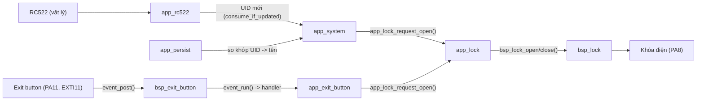
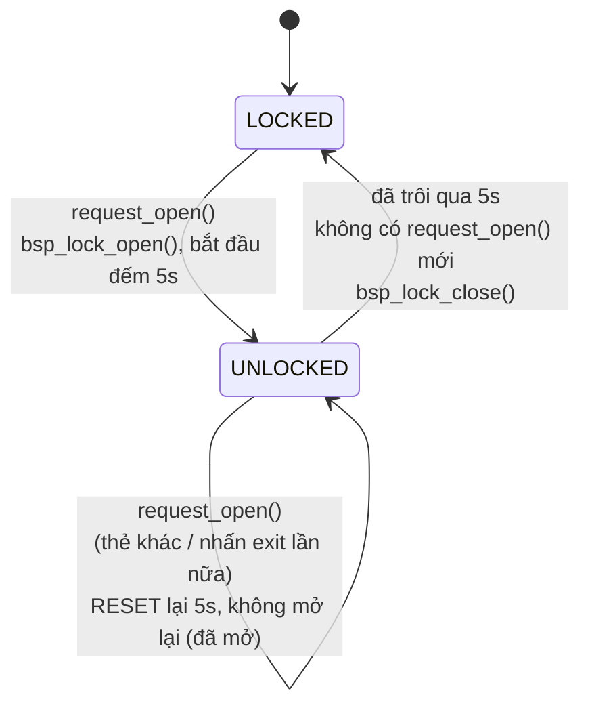
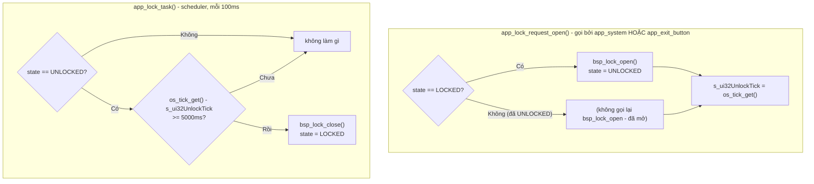

# app_lock — Máy trạng thái điều khiển khóa

`Dev/1.Application/app_lock` là module **duy nhất** được phép điều khiển khóa điện (qua
[`bsp_lock`](modules.md#2bsp-gan-device-vao-board-that), PA8). Nó không biết gì về RC522, nút
exit, bàn phím hay EEPROM — mọi nơi khác chỉ được phép **ra lệnh** cho nó qua đúng 1 hàm:
`app_lock_request_open()`.

## Tách biệt bằng "command" — không phải bằng biến global

> "Tách biệt app này ra khỏi các app khác bằng cách sử dụng một biến command yêu cầu mở cửa."

Đúng tinh thần đó, nhưng theo quy ước đã có của dự án (xem [app_rtc](modules.md#app_rtc)/
[app_rc522](modules.md#app_rc522)'s `get_latest`/`consume_if_updated`): chia sẻ trạng thái giữa
các module `app_*` luôn đi qua **hàm**, không qua `extern` global để module khác tự ý đọc/ghi.
`app_lock_request_open()` chính là "biến command" đó, chỉ là được bọc trong một hàm thay vì một
biến thô — hiệu quả giống nhau (ai cũng gọi được, `app_lock` không cần biết là ai), nhưng giữ được
tính đóng gói mà dự án đã áp dụng xuyên suốt.



## Dữ liệu đầu vào (data input) của app_lock

`app_lock` chỉ có **một** input logic — lệnh `request_open()` — nhưng 2 nguồn khác nhau gọi nó
vì 2 lý do khác nhau:

| Nguồn gọi | Cơ chế | Khi nào gọi | UC |
|---|---|---|---|
| `app_system` | Scheduler task, 100ms — đọc `app_rc522_consume_if_updated()`, so khớp qua `app_persist_user_find_by_uid()` | UID mới quẹt **và** khớp danh sách đã lưu | UC-02 |
| `app_exit_button` | Event handler, chạy từ `event_run()` khi `bsp_exit_button`'s `EXTI15_10_IRQHandler` post `BSP_EXIT_BUTTON_EVENT_PRESSED` | Nút exit được nhấn (PA11 kéo xuống) | UC-03 |

`app_lock` không phân biệt được 2 nguồn trên — và **không cần phân biệt**: cả 2 trường hợp đều
chỉ là "có người cho phép mở cửa ngay bây giờ", xử lý giống nhau.

!!! note "UC-01 (mở khóa bằng PIN) đã bị loại bỏ khỏi phạm vi"
    Xem [use-cases.md#uc-01](../use-cases.md#uc-01-mo-khoa-bang-pin-a-loai-bo-khoi-pham-vi) —
    quyết định chỉ xác thực user qua thẻ RFID, không qua PIN (lý do: PIN không tự nhiên phân biệt
    được 2 người như UID). `app_keypad` vẫn còn dùng, nhưng chỉ cho việc nhập master password để
    vào `ADMIN_AUTH`/`ADMIN_MENU` (xem [app-system.md](app-system.md)), không phải một nguồn thứ
    3 gọi `app_lock_request_open()`.

## Máy trạng thái

Chỉ 2 trạng thái — `LOCKED` (khóa đóng, mặc định) và `UNLOCKED` (khóa mở, đang đếm 5s):



Đúng 3 quy tắc đề bài đặt ra:

1. **Thẻ hợp lệ → mở 5s**: `LOCKED --request_open()--> UNLOCKED`.
2. **Có thẻ khác trong 5s đó → tiếp tục mở thêm 5s**: cạnh tự-vòng `UNLOCKED --request_open()--> UNLOCKED` — mỗi lần gọi đều ghi lại mốc thời gian (`os_tick_get()`), không quan tâm đang `LOCKED` hay `UNLOCKED`.
3. **Nhấn exit cũng mở 5s**: `app_exit_button` gọi đúng `request_open()` — không có đường nào khác để mở khóa.

### `app_lock_task()` và `app_lock_request_open()` — ai làm gì



Điểm mấu chốt: `request_open()` **luôn** ghi lại mốc thời gian mới ở bước `A4`, bất kể đang
`LOCKED` hay đã `UNLOCKED` — đây chính là cơ chế "mở thêm 5s" khi có thẻ/nút nhấn thứ 2. Việc
đóng khóa chỉ xảy ra trong `app_lock_task()`, không bao giờ trong `request_open()`.

## Debounce nút exit — ở app_exit_button, không phải ở bsp_exit_button

`EXTI15_10_IRQHandler` (ISR) vẫn không debounce gì — mỗi lần rung tiếp điểm làm ngắt nổ, nó cứ
`event_post()` (set 1 cờ, idempotent, an toàn trong ngắt). Debounce thật nằm ở
`app_exit_button_on_press()` (chạy từ `event_run()`, main-loop context — không phải ISR):

```c
#define APP_EXIT_BUTTON_DEBOUNCE_MS  (200u)

static uint32_t s_ui32LastAcceptedTick = 0U;
static bool s_bHasAcceptedBefore = false;

void app_exit_button_on_press(void)
{
    uint32_t ui32Now = os_tick_get();

    if (s_bHasAcceptedBefore && ((ui32Now - s_ui32LastAcceptedTick) < APP_EXIT_BUTTON_DEBOUNCE_MS)) {
        return; /* debounce - khả năng cao là rung tiếp điểm của đúng lần nhấn vừa chấp nhận */
    }

    s_ui32LastAcceptedTick = ui32Now;
    s_bHasAcceptedBefore = true;

    app_lock_request_open();
    app_system_notify_exit_pressed();
    app_log_record(APP_LOG_SOURCE_EXIT, NULL);
}
```

!!! note "Trước đây từng không debounce — đổi ý theo yêu cầu, không phải vì logic cũ sai"
    Phiên bản trước lập luận: gọi lại `request_open()`/`event_post()` nhiều lần do rung tiếp điểm
    vẫn *an toàn* (không gây sai lệch trạng thái) nên không cần debounce. Điều đó vẫn đúng về mặt
    kỹ thuật — nhưng **không lý tưởng**: mỗi lần rung vẫn tạo thêm 1 record log trùng giây
    (`app_log_record`, UC-09) và chạy lại toàn bộ 3 lời gọi không cần thiết. Debounce 200ms ở
    `app_exit_button` giải quyết đúng chỗ đó: ISR vẫn đơn giản tối đa (chỉ set cờ), còn việc "đây
    có phải cùng 1 lần nhấn hay không" được quyết định ở nơi có khái niệm thời gian rõ ràng
    (`os_tick_get()`), không phải trong ngắt.

## Tham chiếu API

| Hàm | Mô tả |
|---|---|
| `app_lock_init()` | Gọi 1 lần trong `app_main()` — khởi tạo `bsp_lock`, state = `LOCKED` |
| `app_lock_task()` | Scheduler task, 100ms — chỉ kiểm & đóng khóa khi hết 5s |
| `app_lock_request_open()` | **Command duy nhất** — mở khóa 5s (hoặc mở thêm 5s nếu đang mở) |
| `app_lock_get_state()` | `LOCKED`/`UNLOCKED` — chưa có consumer (dành cho LCD/status sau này) |

## Module liên quan (mới, cùng đợt)

| Module | Vai trò |
|---|---|
| `Dev/2.BSP/bsp_lock` | PA8, output — giả định fail-secure (mất điện = khóa), xem ghi chú polarity trong `bsp_lock.h` |
| `Dev/2.BSP/bsp_exit_button` | PA11, input pull-up + EXTI11 falling-edge — post `BSP_EXIT_BUTTON_EVENT_PRESSED` |
| `Dev/1.Application/app_exit_button` | Event handler — chỉ gọi `app_lock_request_open()` |
| `Dev/1.Application/app_system` | Scheduler task — cầu nối `app_rc522` + `app_persist` → `app_lock`, theo UC-02 |

Đây cũng là **lần đầu `Dev/4.MiddleWare/event` có một consumer thật** (RC522 đã thử rồi bỏ — xem
[event](modules.md#event)): nút exit là một input rời rạc, không cần "hỏi" định kỳ như thẻ RFID,
nên EXTI ở đây thực sự thay được việc poll thay vì chỉ lặp lại một chờ-đợi driver đã làm sẵn.
