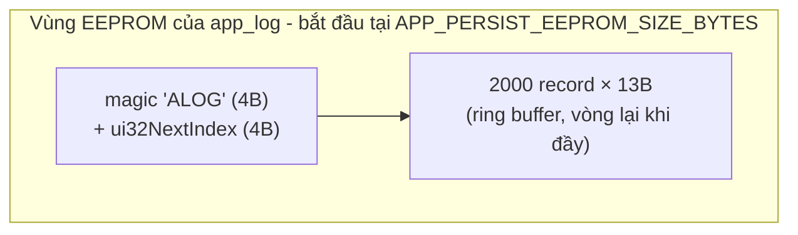
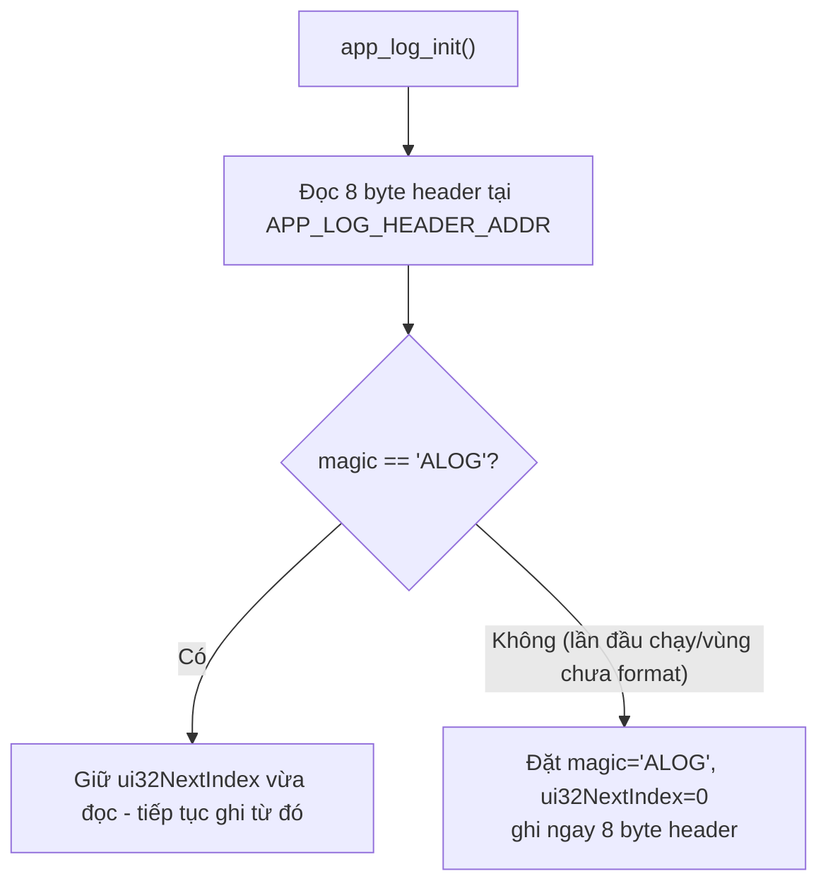
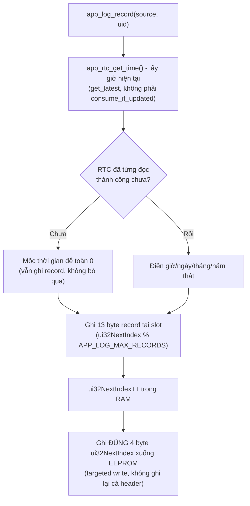

# app_log — Ghi log lịch sử ra/vào (UC-09)

`Dev/1.Application/app_log` là ring buffer ghi lại mỗi sự kiện mở khóa (quẹt thẻ khớp/không khớp,
nhấn nút exit) vào EEPROM 24C256, ngay sau vùng của
[`app_persist`](app-persist.md). Không có scheduler task — chỉ ghi theo sự kiện, gọi trực tiếp từ
`app_system`/`app_exit_button` khi có chuyện xảy ra, giống cách `app_persist`'s hàm ghi được gọi
trực tiếp chứ không polling.

## Vị trí trong EEPROM — tính toán, không viết cứng số 2117

```c
/* app_persist.h */
#define APP_PERSIST_EEPROM_SIZE_BYTES \
    (4u + 1u + APP_PERSIST_ADMIN_PASSWORD_LEN + 1u + \
     (APP_PERSIST_MAX_USERS * (RC522_UID_LEN + APP_PERSIST_NAME_LEN + 1u)) + 2u)

/* app_log.c */
#define APP_LOG_HEADER_ADDR   (APP_PERSIST_EEPROM_SIZE_BYTES)
```

!!! warning "Vì sao tính toán thay vì viết số 2117 trực tiếp"
    `APP_PERSIST_MAX_USERS` đã từng đổi 1 lần (32→100, xem [app-persist.md](app-persist.md)) và
    kéo theo offset `2117` đổi theo. Nếu `app_log.c` viết cứng `2117`, lần đổi `app_persist`
    layout **tiếp theo** sẽ khiến `app_log` âm thầm ghi đè lên vùng `app_persist` (hoặc để trống
    1 khoảng không dùng) mà không ai biết — `APP_PERSIST_EEPROM_SIZE_BYTES` tính từ đúng các
    hằng số công khai `app_persist.h` đã dùng để tự mô tả layout của chính nó, nên luôn đúng theo
    layout thực tế tại thời điểm build, không phải một con số chép tay có thể lạc hậu.

## Cấu trúc lưu trữ

| Offset (từ `APP_LOG_HEADER_ADDR`) | Size | Field |
|---|---|---|
| 0 | 4 | magic `"ALOG"` |
| 4 | 4 | `ui32NextIndex` — slot kế tiếp sẽ ghi, `% APP_LOG_MAX_RECORDS` để vòng lại |
| 8 | 2000 × 13 = 26000 | Bảng record, mỗi record 13 byte — xem bảng dưới |

Mỗi **record** (`app_log_record_t`, `__attribute__((packed))`):

| Offset trong record | Size | Field |
|---|---|---|
| 0-5 | 6×1 | `ui8Seconds, ui8Minutes, ui8Hours, ui8Day, ui8Date, ui8Month` |
| 6 | 2 | `ui16Year` |
| 8 | 1 | `ui8Source` — `app_log_source_t`: `RFID_GRANTED` (0) / `RFID_DENIED` (1) / `EXIT` (2) |
| 9-12 | 4×1 | `ui8Uid[4]` — toàn 0 cho nguồn `EXIT` (không có thẻ) |

Tổng vùng: 8 (header) + 26000 (2000 record) = 26008 byte, nằm trong khoảng ~30.6KB còn trống sau
`app_persist` (32768 − 2117 = 30651) — còn dư ~4600 byte không dùng tới.



## Vòng đời: nạp & tự phục hồi (`app_log_init`)



Khác `app_persist`: **không có CRC** cho vùng log. Nếu 1 record bị hỏng do mất điện giữa lúc
ghi, chỉ record đó sai — không ảnh hưởng các record khác, và không có cơ chế nào "reset hết log"
chỉ vì 1 record lỗi. Đây là đánh đổi có chủ đích: log được xem là dữ liệu "mất một chút không
sao" (khác bảng UID/admin password, nơi một CRC sai sẽ xoá hết vì dữ liệu đó quan trọng để hệ
thống hoạt động đúng).

## Luồng ghi 1 record (`app_log_record`)



Dùng `app_rtc_get_time()` (không phải `app_rtc_consume_if_updated()`) vì log phản ứng theo
**sự kiện của chính nó** (có người quẹt thẻ/nhấn exit) — đúng use case `get_latest` đã mô tả
trong [Task & Data Flow](tasks-dataflow.md#pattern-cache-2-accessor-dung-chung-cho-moi-nguon-du-lieu-bat-ong-bo):
không quan tâm giờ vừa đổi hay đã cũ, chỉ cần giá trị đúng tại thời điểm ghi log.

## Nơi gọi `app_log_record()`

| Gọi từ | Khi nào | Nguồn (`app_log_source_t`) |
|---|---|---|
| `app_system_tick_idle()` | UID quẹt khớp danh sách | `APP_LOG_SOURCE_RFID_GRANTED` |
| `app_system_tick_idle()` | UID quẹt không khớp | `APP_LOG_SOURCE_RFID_DENIED` |
| `app_exit_button_on_press()` | Mỗi lần ngắt EXTI11 nổ (nút exit) | `APP_LOG_SOURCE_EXIT` (uid = `NULL`) |

!!! info "Ghi log nút exit không điều kiện — khác app_system_notify_exit_pressed()"
    `app_exit_button_on_press()` gọi `app_log_record()` **luôn luôn**, không như
    `app_system_notify_exit_pressed()` (chỉ có tác dụng nếu `app_system` đang ở `IDLE`, xem
    [app-system.md](app-system.md)). Lý do: sự kiện mở khóa qua nút exit xảy ra thật mỗi lần
    nhấn (khóa luôn mở), bất kể LCD có đang hiển thị gì — log phải phản ánh đúng việc đó, không
    phụ thuộc trạng thái hiển thị.

## Tham chiếu API

| Hàm | Mô tả |
|---|---|
| `app_log_init()` | Gọi 1 lần trong `app_main()`, ngay sau `app_persist_init()` |
| `app_log_record(source, uid)` | Ghi 1 record — `uid` có thể `NULL` (nguồn `EXIT`) |

## Chưa xây — là việc tiếp theo

Chưa có cách **đọc lại** log từ bên ngoài (qua UART debug console hoặc màn hình LCD liệt kê lịch
sử) — dữ liệu đã ghi đúng và đọc được bằng code, nhưng chưa có giao diện người dùng nào hiển thị
lại. UART debug console nằm ngoài phạm vi tài liệu này (xem đầu [use-cases.md](../use-cases.md)).
