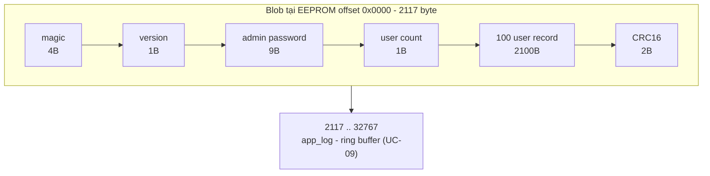
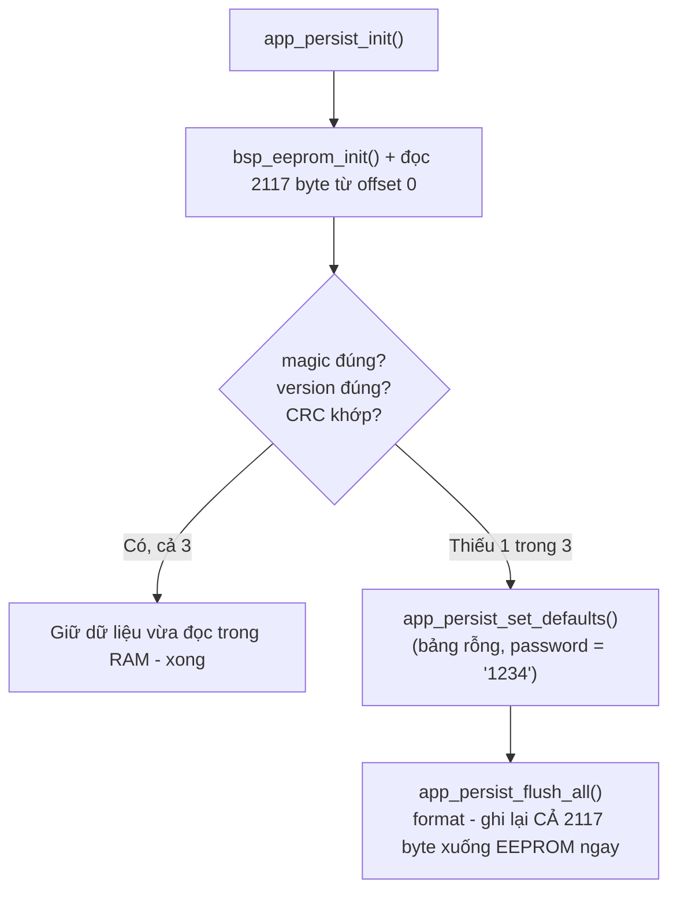
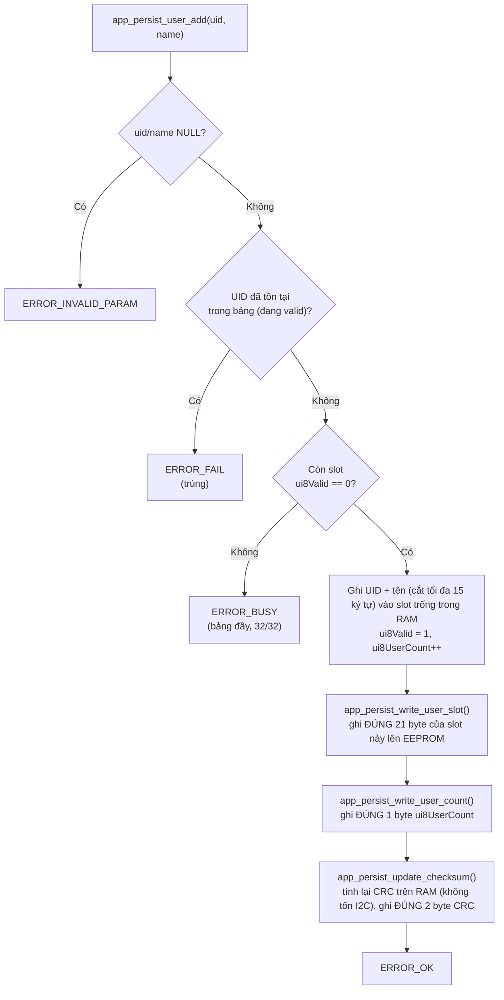
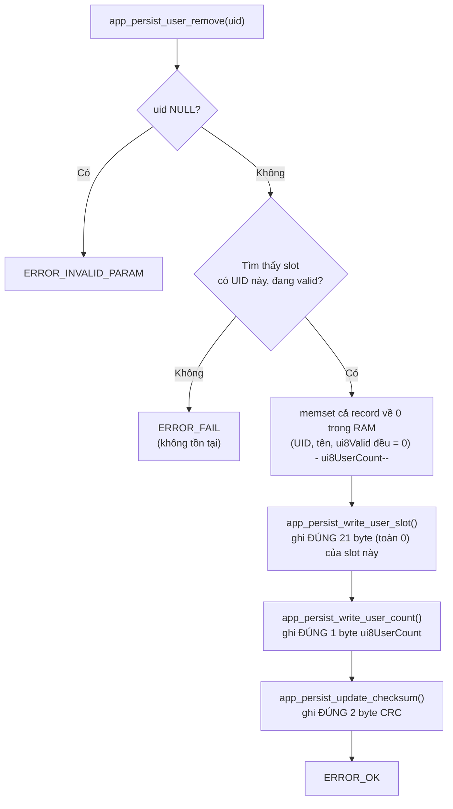

# app_persist — Lưu trữ admin password & danh sách UID trong EEPROM

`Dev/1.Application/app_persist` là nơi lưu **duy nhất** cho mật khẩu quản trị (master
password, UC-08) và danh sách thẻ RFID hợp lệ kèm tên hiển thị (UID + tên, phục vụ UC-02,
UC-06, UC-07). Dữ liệu nằm trong EEPROM 24C256 qua [`bsp_eeprom`](modules.md#2bsp-gan-device-vao-board-that),
nhưng mọi nơi khác trong firmware **không được đọc/ghi EEPROM trực tiếp** — phải đi qua API
của module này, để đảm bảo CRC/magic luôn nhất quán và cache RAM không bị lệch với EEPROM thật.

!!! note "Khác hẳn cách `app_rtc`/`app_rc522` cache dữ liệu"
    `app_rtc`/`app_rc522` đọc lại phần cứng **liên tục** mỗi vài trăm ms và cache kèm số phiên
    bản (`consume_if_updated`) vì dữ liệu đổi nhanh. Dữ liệu ở đây **hiếm đổi** — chỉ khi admin
    chủ động thêm/xoá user hoặc đổi mật khẩu — nên không cần task định kỳ: nạp **một lần** vào
    RAM lúc `app_persist_init()`, mọi lần đọc lấy thẳng từ RAM (0 giao dịch I2C). Mỗi lần thay
    đổi, chỉ **đúng vùng đã đổi** (1 record user, hoặc trường password, cộng CRC) được ghi
    xuống EEPROM — không ghi lại toàn bộ 2117 byte mỗi lần, xem [Luồng thêm/xoá user](#luong-them-user-app_persist_user_add)
    bên dưới. Ngoại lệ duy nhất là lúc format toàn bộ EEPROM (lần đầu chạy hoặc factory reset) —
    lúc đó ghi lại hết là đúng, vì mọi thứ đều thay đổi thật.

## Cấu trúc lưu trữ trong EEPROM

Một blob liên tục duy nhất bắt đầu tại địa chỉ `0x0000`, khai báo bằng
`__attribute__((packed))` để cố định đúng layout byte-theo-byte (không phụ thuộc compiler có
chèn padding hay không — quan trọng vì đây là dữ liệu ghi xuống EEPROM, phải đọc lại đúng y
nguyên dù build lại firmware):

| Offset | Size (byte) | Field | Ghi chú |
|---|---|---|---|
| 0 | 4 | `pui8Magic` | `"ACPS"` — phát hiện EEPROM chưa format hoặc sai layout |
| 4 | 1 | `ui8Version` | hiện = **2** (v1 dùng `APP_PERSIST_MAX_USERS=32`, kích thước/offset khác — xem cảnh báo bên dưới); tăng khi đổi layout để phân biệt "cũ" với "hỏng" |
| 5 | 9 | `szAdminPassword` | ASCII, NUL-pad, tối đa 8 ký tự |
| 14 | 1 | `ui8UserCount` | số slot đang dùng, `<= APP_PERSIST_MAX_USERS` (100) |
| 15 | 2100 | `pUsers[100]` | 100 record × 21 byte — xem bảng bên dưới |
| 2115 | 2 | `ui16Checksum` | CRC16-CCITT (poly `0x1021`, init `0xFFFF`) trên 2115 byte phía trên |

**2100 byte/record** không phải là unit — mỗi **record user** (`app_persist_user_rec_t`) dài
21 byte:

| Offset trong record | Size | Field |
|---|---|---|
| 0 | 4 | `ui8Uid[4]` |
| 4 | 16 | `szName[16]` — NUL-pad, khớp đúng độ rộng dòng LCD 16x2 |
| 20 | 1 | `ui8Valid` — **trường used/unused**: 0 = slot trống (chưa dùng hoặc đã xoá), 1 = đang dùng |

Tổng blob = 4+1+9+1+(100×21)+2 = **2117 byte** (hằng số công khai `APP_PERSIST_EEPROM_SIZE_BYTES`
trong `app_persist.h`, **tính toán** từ các hằng số trên, không phải số viết cứng — xem lý do ở
[app-log.md](app-log.md)) — chỉ chiếm ~6.5% dung lượng 24C256 (32768 byte). Toàn bộ phần **từ
offset `APP_PERSIST_EEPROM_SIZE_BYTES` trở đi** đã được `app_log` dùng làm ring buffer ghi log
(UC-09, xem [app-log.md](app-log.md)) — không module nào khác được đè lên vùng này.

!!! warning "Đổi `APP_PERSIST_MAX_USERS` là đổi layout — bắt buộc tăng version"
    Ban đầu module này dùng `APP_PERSIST_MAX_USERS = 32` (version 1, blob 689 byte). Khi tăng lên
    100, kích thước bảng user và offset của `ui16Checksum` đều đổi — một EEPROM đã ghi dữ liệu ở
    layout cũ, nếu đọc bằng code mới mà không đổi version, sẽ bị đọc sai offset (coi 68 byte đầu
    của record user thứ 2 cũ là... CRC) mà **không hề báo lỗi**. Đây chính là lý do
    `APP_PERSIST_VERSION` tồn tại: tăng từ 1 lên 2 khi đổi `APP_PERSIST_MAX_USERS`, để
    `app_persist_init()` thấy version không khớp và **tự reset về mặc định** (xem mục tiếp theo)
    thay vì đọc nhầm dữ liệu cũ.

## Vòng đời: nạp & tự phục hồi (`app_persist_init`)

Cả 3 điều kiện có thể sai cùng lúc trong 3 trường hợp: **lần đầu chạy** (EEPROM mới, toàn
`0xFF`/`0x00`), **EEPROM hỏng/nhiễu** (CRC lệch), hoặc **firmware mới đổi layout**
(`APP_PERSIST_VERSION` tăng nhưng EEPROM còn format cũ). Cả 3 trường hợp đều xử lý giống nhau:
reset về mặc định — đây cũng chính là toàn bộ nội dung của `app_persist_factory_reset()` (UC-10),
chỉ là gọi theo yêu cầu thay vì tự động lúc boot.

## Luồng thêm user (`app_persist_user_add`)

## Luồng xoá user (`app_persist_user_remove`)

Xoá chỉ đặt `ui8Valid = 0` (và xoá sạch nội dung record) — **không** dồn các slot phía sau lên
để lấp chỗ trống. Slot đã xoá trở thành slot trống bình thường, sẽ được `user_add()` tái sử dụng
cho lần thêm tiếp theo. Vì vậy chỉ số truyền cho `app_persist_user_get_by_index()` không phải là
chỉ số thô trong mảng `pUsers[32]`, mà là **thứ tự trong số các slot đang `valid`** — xem API bên
dưới.

!!! info "Chi phí mỗi lần ghi: chỉ đúng vùng đổi, không phải toàn bộ blob"
    Mỗi lần `user_add`/`user_remove`/`admin_password_set` chỉ ghi EEPROM **3 lần nhỏ**: 1 record
    user (21 byte, hoặc 9 byte cho trường password) + 1 byte `ui8UserCount` + 2 byte CRC — tổng
    ~24 byte (chưa đến 1 trang EEPROM/5ms write-cycle), so với ~170ms nếu ghi lại cả 2117 byte.
    Vị trí ghi được tính bằng `offsetof(app_persist_data_t, field)` (xem `app_persist_write_range()`
    trong `.c`) chứ không hard-code số — layout đổi (ví dụ `APP_PERSIST_MAX_USERS` tăng lần nữa)
    tự động tính đúng offset mới, không cần sửa tay từng lời gọi.

    CRC vẫn luôn tính trên **toàn bộ** struct trong RAM (rẻ, không tốn I2C) trước khi ghi — chỉ
    *ghi xuống EEPROM* 2 byte CRC đó. Điều này chỉ đúng vì mọi trường khác đã được ghi xuống
    EEPROM đồng bộ với RAM ngay sau khi đổi, không có trường nào "nợ" lại.

    **Đánh đổi cần biết**: nếu mất điện giữa lúc ghi record và lúc ghi CRC, EEPROM sẽ có record
    mới nhưng CRC cũ (không khớp) — `app_persist_init()` lần sau sẽ phát hiện CRC sai và **reset
    toàn bộ về mặc định** (mất hết user, không chỉ record đang ghi). Đây là đánh đổi có chủ đích:
    ghi nhanh, ít hao EEPROM, nhưng không có cơ chế ghi an toàn kiểu transaction/journal (vốn
    không cần cho một thiết bị lab ít khi mất điện giữa lúc admin đang thêm/xoá user).

## Tham chiếu API

| Hàm | Trả về | Dùng cho (UC) |
|---|---|---|
| `app_persist_init()` | — | Gọi 1 lần đầu tiên trong `app_main()`, trước mọi `app_xxx_init()` khác |
| `app_persist_factory_reset()` | — | UC-10 — reset admin password + xoá toàn bộ user, ghi ngay |
| `app_persist_admin_password_check(pszPassword)` | `bool` | UC-08 — xác thực trước khi vào menu quản trị |
| `app_persist_admin_password_set(pszNewPassword)` | `ERROR_OK` / `ERROR_INVALID_PARAM` (NULL hoặc > 8 ký tự) | UC-08 — đổi mật khẩu quản trị |
| `app_persist_user_add(pui8Uid, pszName)` | `ERROR_OK` / `ERROR_INVALID_PARAM` / `ERROR_FAIL` (trùng) / `ERROR_BUSY` (đầy) | UC-06 — thêm user mới |
| `app_persist_user_remove(pui8Uid)` | `ERROR_OK` / `ERROR_INVALID_PARAM` / `ERROR_FAIL` (không có) | UC-07 — xoá user |
| `app_persist_user_find_by_uid(pui8Uid, pszNameOut)` | `bool` | **UC-02** — bước "so khớp UID", `pszNameOut` dùng để hiển thị "Welcome `<tên>`" trên LCD |
| `app_persist_user_count()` | `uint32_t` | UC-06/07 — admin menu biết có bao nhiêu user để enumerate |
| `app_persist_user_get_by_index(ui32Index, pui8Uid, pszNameOut)` | `bool` | UC-06/07 — admin menu cuộn/liệt kê user trên LCD (chỉ số theo thứ tự slot *đang dùng*, không phải chỉ số thô) |

!!! info "Không thêm mã lỗi mới cho module này"
    `ERROR_BUSY`/`ERROR_FAIL` ở trên là mã lỗi **chung** (`5.Utils/define.h`), được tái dùng với
    ý nghĩa riêng cho `app_persist` (đầy bảng / trùng-hoặc-không-tồn-tại) — giống cách
    `rc522_read_uid()` dùng `ERROR_FAIL` cho lỗi BCC. Không tạo thêm hằng số dùng chung mới chỉ
    vì một module cần.

## Đã có người gọi — không còn API nào "viết trước, chưa ai dùng"

Khác với lúc trang này mới viết (chỉ `app_persist_init()` được gọi, mọi hàm khác bị
`--gc-sections` loại khỏi `.elf`), `app_system` (xem [app-system.md](app-system.md)) giờ là
người gọi thật cho **toàn bộ** API còn lại: `admin_password_check()`/`user_find_by_uid()` (UC-02,
mỗi lần quẹt thẻ), `user_add()`/`user_remove()`/`admin_password_set()` (UC-06/07/08, qua menu
quản trị trên LCD), và `factory_reset()` (UC-10, qua `ADMIN_FACTORY_RESET_CONFIRM`, xác nhận lại
bằng admin password trước khi gọi). Xác nhận bằng `arm-none-eabi-nm build/RFID.elf`: tất cả hàm
public của `app_persist` đều nằm trong `.elf` cuối. Xem [Task & Data Flow](tasks-dataflow.md) để
biết bức tranh tổng thể các module đã nối.
