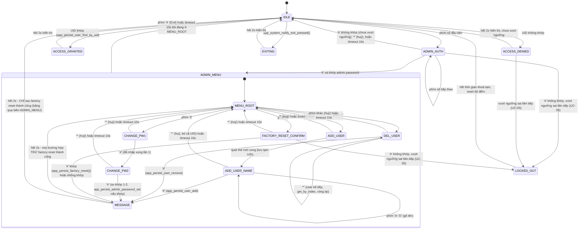

# app_system — Điều phối hệ thống & điều khiển hiển thị LCD

!!! success "Đã triển khai và chạy thật"
    Trang này ban đầu là thiết kế đề xuất; đã được code đúng theo sơ đồ dưới đây -
    `app_system.c` (máy trạng thái đầy đủ) + `Dev/2.BSP/bsp_lcd` + `Dev/1.Application/app_lcd`.
    Xác nhận bằng `arm-none-eabi-nm`: toàn bộ hàm `app_system_tick_*`/`bsp_lcd_*`/`app_lcd_*`
    đều nằm trong `.elf` cuối (không bị `--gc-sections` loại) - khác với nhiều module khác trong
    dự án vẫn còn "viết trước khi có người gọi". Một vài khác biệt nhỏ so với bản đề xuất gốc
    được ghi chú trực tiếp trong các mục dưới.

## Vai trò của app_system

`app_system` là **bộ điều phối trung tâm**: nơi duy nhất quyết định "hệ thống đang ở trạng thái
gì" và "LCD nên hiển thị gì" — tương tự cách `app_lock` là nơi duy nhất quyết định khóa đóng/mở.
`app_rc522`, `app_keypad`, `app_persist`, `app_rtc` vẫn không biết gì về nhau hay về LCD;
`app_system` là module duy nhất đọc tất cả và quyết định.

`app_lcd` chỉ là một "con rối" vẽ lại đúng nội dung `app_system` quyết định — giống cách `app_lock`
không tự quyết định khi nào mở, chỉ thực thi lệnh từ nơi khác gọi vào. `app_lcd_task()` (100ms,
`g_pTaskTable`) chỉ gọi `app_system_consume_display_if_updated()` rồi `bsp_lcd_set_line()` cho cả
2 dòng nếu có thay đổi — không có logic nào khác trong `app_lcd.c`.

## Dữ liệu đầu vào (data input)

| Nguồn | Hàm gọi | Dữ liệu | Dùng khi nào |
|---|---|---|---|
| `app_rc522` | `app_rc522_consume_if_updated()` | UID[4] mới | Bất kỳ lúc nào ở `IDLE` — quẹt thẻ luôn được xử lý ngay |
| `app_keypad` | `app_keypad_get_key()` | 1 ký tự (`0`-`9`, `*`, `#`) | `IDLE` (phím đầu → vào `ADMIN_AUTH`), `ADMIN_AUTH` (tích luỹ master password), `ADMIN_MENU` (chọn chức năng) — **chỉ dùng để vào menu quản trị, không dùng để mở cửa** (UC-01 đã loại bỏ, xem cảnh báo dưới) |
| `app_persist` | `user_find_by_uid()`, `admin_password_check()`, `user_add/remove()`, `user_count/get_by_index()`, `factory_reset()` (UC-10, trigger qua `ADMIN_FACTORY_RESET_CONFIRM`) | Kết quả so khớp / tên user / kết quả ghi | Theo yêu cầu tại từng bước, không polling |
| `app_rtc` | `app_rtc_consume_if_updated()` | Giờ hiện tại | `IDLE` — chỉ cập nhật dòng hiển thị giờ, **không đổi state** |
| `app_exit_button` | `app_system_notify_exit_pressed()` | "nút exit vừa được nhấn" | `IDLE` → `EXITING` |

!!! info "Nối thêm 1 lời gọi trong app_exit_button_on_press(), không sửa app_lock"
    `app_exit_button_on_press()` vẫn gọi `app_lock_request_open()` như trước (xem
    [app-lock.md](app-lock.md)) — `app_lock` không cần biết `app_system` tồn tại. Thêm đúng 1
    lời gọi **song song** tới `app_system_notify_exit_pressed()` để `app_system` biết hiển thị
    "Exiting..." - nếu `app_system` không đang ở `IDLE` lúc đó, hàm này không làm gì (khóa vẫn đã
    mở ở lời gọi trước, chỉ phần hiển thị bị bỏ qua).

## Dữ liệu đầu ra (data output)

| Đích | Cách gửi | Nội dung |
|---|---|---|
| `app_lock` | `app_lock_request_open()` | Lệnh mở khóa — khi `ACCESS_GRANTED` (chỉ từ quẹt thẻ khớp, UC-02 — không còn đường PIN, xem UC-01) |
| `app_lcd` | `app_system_consume_display_if_updated()` | 2 dòng text hiện tại, cache + số phiên bản — **đúng pattern `app_rtc`/`app_rc522` đã dùng** |
| `app_log` | `app_log_record(source, uid)` | Ghi 1 record log (UC-09) — gọi khi vào `ACCESS_GRANTED` (nguồn `APP_LOG_SOURCE_RFID_GRANTED`) và `ACCESS_DENIED` (`APP_LOG_SOURCE_RFID_DENIED`), xem [app-log.md](app-log.md). `app_exit_button` cũng gọi thẳng, không qua `app_system` |

```c
typedef struct {
    char szLine1[APP_SYSTEM_DISPLAY_LINE_LEN];  /* 17 = 16 ký tự + NUL, khớp độ rộng LCD 16x2 */
    char szLine2[APP_SYSTEM_DISPLAY_LINE_LEN];
} app_system_display_t;

bool app_system_consume_display_if_updated(app_system_display_t *pOut, uint32_t *pui32LastSeenSeq);
```

Dùng `consume_if_updated` (không phải `get_latest`) vì `app_lcd` sẽ là task định kỳ (ví dụ
100ms) và chỉ nên vẽ lại LCD khi nội dung **thực sự đổi** — giống lý do `app_rtc` được thiết kế
vậy ngay từ đầu (xem [Task & Data Flow](tasks-dataflow.md#pattern-cache-2-accessor-dung-chung-cho-moi-nguon-du-lieu-bat-ong-bo)).

## Các trạng thái

### Trạng thái cha (top-level) — máy trạng thái chính của `app_system`

| State cha | Hiển thị LCD | Vào từ | Ra khi |
|---|---|---|---|
| `IDLE` | Dòng 1: giờ hiện tại · Dòng 2: "Quet the de mo" | Mặc định lúc boot; mọi state khác quay về | Phím đầu → `ADMIN_AUTH`; UID quẹt → `ACCESS_GRANTED`/`ACCESS_DENIED`; exit được nhấn → `EXITING` |
| `ADMIN_AUTH` | "Admin password:" / `****` (số `*` = số ký tự đã nhập) | `IDLE`, phím đầu tiên | `#` và khớp admin password → `ADMIN_MENU`; `#` và không khớp → `IDLE` (hoặc → `LOCKED_OUT` nếu vượt ngưỡng sai liên tiếp, UC-05); `*` (huỷ) hoặc không phím mới > 10s → về `IDLE` |
| `ADMIN_MENU` | Menu "1Add 2Del 3Pw"/"4Exit 5Reset" | `ADMIN_AUTH`, `#` khớp admin password | **Trạng thái cha (composite)** - có 7 trạng thái con bên trong, xem bảng và sơ đồ dưới |
| `ACCESS_GRANTED` | "Access Granted" + tên user | `IDLE`, UID quẹt khớp (UC-02, **chỉ nguồn này**) | Hết 2s hiển thị → `IDLE` (khóa vẫn tự quản 5s riêng qua `app_lock`, xem ghi chú) |
| `ACCESS_DENIED` | "Unknown Card" | `IDLE`, UID quẹt không khớp | Hết 2s hiển thị → `IDLE` (hoặc → `LOCKED_OUT` nếu vượt ngưỡng sai liên tiếp, UC-05) |
| `LOCKED_OUT` | "Locked, wait:" + số giây còn lại | `ACCESS_DENIED`, `ADMIN_AUTH`, **hoặc** `ADMIN_FACTORY_RESET_CONFIRM`, vượt ngưỡng (`APP_SYSTEM_MAX_FAILED_ATTEMPTS` = 5, 2 bộ đếm riêng - xem ghi chú dưới) | Hết thời gian khoá tạm (`APP_SYSTEM_LOCKOUT_DURATION_MS` = 30s) → `IDLE`, reset **cả 2** bộ đếm về 0 |
| `EXITING` | "Exiting..." | `IDLE`, `app_system_notify_exit_pressed()` được gọi | Hết 2s hiển thị → `IDLE` |

!!! info "Không còn PIN mở cửa — ADMIN_AUTH chỉ dẫn tới ADMIN_MENU hoặc IDLE, không bao giờ tới ACCESS_GRANTED"
    UC-01 (mở khóa bằng PIN) đã bị loại bỏ khỏi phạm vi — xem
    [use-cases.md](../use-cases.md#uc-01-mo-khoa-bang-pin-a-loai-bo-khoi-pham-vi). Vì vậy
    `ADMIN_AUTH` chỉ có 2 kết cục khi khớp/huỷ/timeout: khớp admin password → `ADMIN_MENU`; còn
    lại → `IDLE` (hoặc `LOCKED_OUT` nếu nhập sai quá nhiều lần liên tiếp, xem ghi chú về 2 bộ đếm
    dưới). Không có nhánh "khớp 1 PIN người dùng khác → `ACCESS_GRANTED`" như bản đề xuất trước
    đó — `app_persist` cũng không cần thêm bảng PIN nào cả, chỉ cần bảng UID đã có.

!!! note "UC-05 dùng 2 bộ đếm sai độc lập, không trộn chung"
    `s_ui32FailedAttempts` (quẹt thẻ sai, tăng trong `app_system_tick_idle()`) và
    `s_ui32AdminFailedAttempts` (nhập sai admin password - tăng trong **cả**
    `app_system_tick_admin_auth()` **và** `app_system_tick_admin_factory_reset_confirm()`, UC-10 -
    2 nơi khác nhau cùng tăng 1 biến, vì cả 2 đều là "thử đoán admin password") là 2 biến tĩnh
    **riêng biệt**, dùng chung ngưỡng `APP_SYSTEM_MAX_FAILED_ATTEMPTS` (= 5) và cùng đích
    `LOCKED_OUT`. Khớp đúng (quẹt đúng thẻ, hoặc nhập đúng password ở 1 trong 2 nơi) chỉ reset bộ
    đếm **của chính nó** ngay lập tức; `LOCKED_OUT` hết hạn thì reset **cả 2** cùng lúc — đơn giản
    hơn là phải nhớ "lockout lần này do nguồn nào gây ra" để chỉ reset đúng 1 bộ đếm.

!!! note "ACCESS_GRANTED chỉ hiển thị 2s, nhưng khóa mở 5s — không mâu thuẫn"
    `app_system`'s `ACCESS_GRANTED` chỉ là **thông báo thoáng qua trên LCD**, tự quay về `IDLE`
    sau 2s. `app_lock` tự quản việc đóng khóa sau 5s **độc lập**, không đồng bộ với LCD — đúng
    tinh thần "app_lock không biết gì về app_system", chỉ nhận lệnh `request_open()` một lần.
    Nếu muốn LCD hiện "Access Granted" suốt 5s thay vì 2s, chỉ cần đổi hằng số hiển thị ở
    `app_system`, không cần sửa `app_lock`.

### Trạng thái con của `ADMIN_MENU`

`ADMIN_MENU` là trạng thái cha duy nhất trong máy trạng thái này — mọi trạng thái con dưới đây
chỉ tồn tại để rồi quay lại `ADMIN_MENU`, **trừ** `ADMIN_FACTORY_RESET_CONFIRM` khi reset thành
công, đường duy nhất thoát thẳng ra `IDLE` từ bên trong (xem ghi chú ngay dưới bảng).

| State con | Vai trò | Hiển thị LCD | Ra khi |
|---|---|---|---|
| `ADMIN_ADD_USER` | Chờ quẹt thẻ mới | "Scan new card" / "then type name" | Quẹt thẻ xong (lưu tạm UID) → `ADMIN_ADD_USER_NAME`; `*`/timeout → về `ADMIN_MENU` |
| `ADMIN_ADD_USER_NAME` | Gõ tên cho thẻ vừa quẹt | "Name(A-D),# ok" + tên đang gõ (hiện chữ thật, không che) | `#` → `app_persist_user_add(uid, tên)` → `ADMIN_MESSAGE`; `*`/timeout → về `ADMIN_MENU` (bỏ cả UID) |
| `ADMIN_DEL_USER` | Duyệt danh sách user để xoá | "Del:#yes *next" + tên user đang xem | `*` → xem user kế (vòng lại); `#` → `app_persist_user_remove()` → `ADMIN_MESSAGE`; phím khác/timeout → về `ADMIN_MENU` |
| `ADMIN_CHANGE_PW1` | Nhập mật khẩu admin mới (lần 1) | "New password:" / `****` | `#` → `ADMIN_CHANGE_PW2`; `*`/timeout → về `ADMIN_MENU` |
| `ADMIN_CHANGE_PW2` | Xác nhận lại (lần 2) | "Confirm again:" / `****` | `#` → so khớp lần 1-2, `app_persist_admin_password_set()` nếu khớp → `ADMIN_MESSAGE`; `*`/timeout → về `ADMIN_MENU` |
| `ADMIN_FACTORY_RESET_CONFIRM` | Nhập lại admin password để xác nhận factory reset (UC-10) | "Confirm w/pass:" / `****` | `#` khớp → `app_persist_factory_reset()` → `ADMIN_MESSAGE` (sẽ đi tới `IDLE`, không phải `ADMIN_MENU`); `#` không khớp → `ADMIN_MESSAGE` (về `ADMIN_MENU`) hoặc `LOCKED_OUT` nếu vượt ngưỡng; `*`/timeout → về `ADMIN_MENU` |
| `ADMIN_MESSAGE` | Hiện kết quả 1 hành động (dùng chung cho cả 4 lựa chọn trên) | Kết quả, ví dụ "User added:"/tên | Hết 2s hiển thị → về `ADMIN_MENU`, **trừ** sau factory reset thành công → về `IDLE` (xem ghi chú dưới) |

!!! info "ADMIN_MESSAGE không phải lúc nào cũng quay lại ADMIN_MENU"
    `app_system_show_message_then(line1, line2, eReturnState)` tổng quát hoá
    `app_system_show_admin_message()` (vốn luôn trả về `ADMIN_MENU`) thêm 1 tham số
    `eReturnState` — chỉ `APP_SYSTEM_STATE_IDLE` (factory reset thành công) hoặc
    `APP_SYSTEM_STATE_ADMIN_MENU` (mọi trường hợp khác) được dùng, lưu trong 1 biến tĩnh
    `s_eMessageReturnState`. Lý do factory reset phải về `IDLE`: master password vừa dùng để vào
    `ADMIN_MENU` **không còn hợp lệ** sau khi reset (đã bị đặt lại `"1234"`) — ở lại `ADMIN_MENU`
    như đang còn đăng nhập hợp lệ sẽ sai về ý nghĩa, dù kỹ thuật không có gì ngăn code tiếp tục
    chạy trong đó.

!!! info "Tên user nhập bằng chữ A-D, không phải A-F"
    Bàn phím 4x4 (`keypad4x4_keymap`) chỉ có đúng 4 phím chữ: `A`, `B`, `C`, `D` (không có `E`/`F`
    - matrix 4x4 chuẩn không có chỗ cho 6 chữ). Vì vậy tên user gõ bằng các phím này giới hạn
    trong 4 chữ cái, không phải A-F như yêu cầu ban đầu - một ràng buộc phần cứng, không phải lựa
    chọn thiết kế. `ADMIN_ADD_USER_NAME` tích luỹ các phím `A`-`D` vào buffer (tối đa
    `APP_PERSIST_NAME_LEN - 1` = 15 ký tự), `#` xác nhận (bỏ qua nếu buffer rỗng), `*` huỷ toàn bộ
    (kể cả UID thẻ đã quẹt ở bước trước).

!!! warning "Trong code, 'trạng thái cha' không phải một khối chứa riêng - chỉ là cách trình bày"
    `app_system_state_t` là **1 enum phẳng** (`typedef enum { ... } app_system_state_t;`) - không
    có kiểu dữ liệu "trạng thái cha chứa trạng thái con" nào trong C. Khi sơ đồ dưới vẽ
    `ADMIN_MENU` là 1 khối chứa 7 state con, đó là cách trình bày cho dễ đọc (đúng quan hệ logic:
    cả 7 state con đều chỉ dẫn tới từ `ADMIN_MENU`, và quay lại `ADMIN_MENU` trừ 1 ngoại lệ đã nêu
    ở trên), không phải một cấu trúc composite-state thật trong code như UML statechart chuẩn.
    `APP_SYSTEM_ADMIN_AUTH_TIMEOUT_MS` (hết hạn không hoạt động) dùng chung cho `ADMIN_MENU` và cả
    7 state con — xem bảng hằng số bên dưới.

## Sơ đồ máy trạng thái đầy đủ (cha + con)



Ánh xạ tên trong sơ đồ ↔ tên hằng số enum thật trong code: `MENU_ROOT` = chính giá trị
`APP_SYSTEM_STATE_ADMIN_MENU` (không có enum riêng, xem cảnh báo ở trên); `ADD_USER`/`DEL_USER`/
`CHANGE_PW1`/`CHANGE_PW2`/`FACTORY_RESET_CONFIRM`/`MESSAGE` = `APP_SYSTEM_STATE_ADMIN_ADD_USER`/
`_DEL_USER`/`_CHANGE_PW1`/`_CHANGE_PW2`/`_FACTORY_RESET_CONFIRM`/`_MESSAGE`; `ADD_USER_NAME` =
`APP_SYSTEM_STATE_ADMIN_ADD_USER_NAME`. Tên trong sơ đồ rút ngắn khỏi tiền tố `ADMIN_` cho dễ đọc.

## Hằng số (trong `app_system.c`)

| Hằng số | Giá trị | Dùng ở |
|---|---|---|
| `APP_SYSTEM_ADMIN_AUTH_TIMEOUT_MS` | 10000 (10s) | Hết hạn không hoạt động ở **mọi** state nhánh admin (`ADMIN_AUTH`, `ADMIN_MENU`, `ADMIN_ADD_USER`, `ADMIN_ADD_USER_NAME`, `ADMIN_DEL_USER`, `ADMIN_CHANGE_PW1/2`) — 1 hằng số dùng chung, không phải riêng cho từng state |
| `APP_SYSTEM_MESSAGE_DURATION_MS` | 2000 (2s) | `ACCESS_GRANTED`/`ACCESS_DENIED`/`EXITING`/`ADMIN_MESSAGE` — thời gian hiển thị trước khi chuyển tiếp |
| `APP_SYSTEM_MAX_FAILED_ATTEMPTS` | 5 | Ngưỡng vào `LOCKED_OUT` (UC-05, dùng chung cho cả 2 bộ đếm - thẻ quẹt sai và admin password sai, xem ghi chú 2 bộ đếm ở trên) |
| `APP_SYSTEM_LOCKOUT_DURATION_MS` | 30000 (30s) | `LOCKED_OUT` — thời gian khoá tạm |

Không có hằng số riêng cho độ dài buffer nhập mật khẩu — giới hạn tích luỹ phím dùng trực tiếp
`APP_PERSIST_ADMIN_PASSWORD_LEN - 1` (từ `app_persist.h`) tại chỗ kiểm tra, để không có 2 hằng số
có thể lệch nhau nếu `app_persist` đổi độ dài này sau.

!!! note "Không có bảng PIN nào được thêm vào app_persist"
    Đúng như quyết định ở UC-01 (xem [use-cases.md](../use-cases.md)) — toàn bộ máy trạng thái
    trên chỉ dùng bảng UID đã có sẵn trong `app_persist`, không cần layout EEPROM mới, không cần
    tăng `APP_PERSIST_VERSION`.
