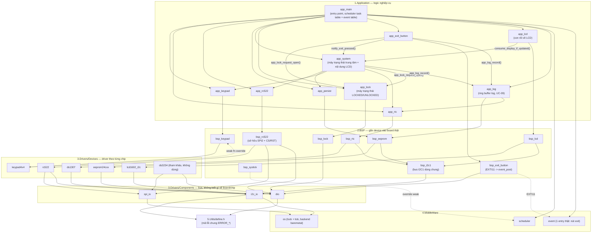

# Kiến trúc phần mềm — Tổng quan

Firmware tổ chức theo **5 lớp**, mỗi lớp chỉ được gọi xuống lớp ngay dưới (không gọi ngược lên,
không nhảy cóc qua lớp). Toàn bộ code tuỳ biến nằm dưới `Firmware/Dev/`; `Firmware/Platform/RFID/`
chỉ chứa code do CubeMX/STM32CubeIDE sinh ra (Core/, Drivers/, `.ioc`, linker script).

## Nguyên tắc phân lớp

| Lớp | Biết gì về board? | Biết gì về chip cụ thể? | Ví dụ |
|---|---|---|---|
| **Components** (`3.Drivers/Components/`) | Không | Không | `i2c_io`, `spi_io`, `dio` — chỉ biết "bus số mấy", "pin số mấy" |
| **Devices** (`3.Drivers/Devices/`) | Không (nhận bus/pin qua init struct) | Có — 1 chip/họ chip | `ds1307`, `eeprom24cxx`, `rc522`, `keypad4x4`, `lcd1602_i2c` |
| **BSP** (`2.BSP/`) | **Có** — hard-code pin/bus thật của board này | Không (gọi Device) | `bsp_rtc` biết DS1307 nằm trên I2C1, PB6/PB7 |
| **Application** (`1.Application/`) | Không trực tiếp (gọi qua BSP) | Không | `app_rtc` không biết DS1307 là I2C hay SPI |
| **MiddleWare/Utils** | Không | Không | `scheduler`, `os`, mã lỗi `ERROR_*` dùng chung mọi lớp |

Hệ quả của cách chia này:

- Đổi board (đổi chân) → chỉ sửa BSP, không đụng Device/Application.
- Đổi chip (ví dụ đổi RTC khác) → viết Device mới, BSP đổi sang gọi Device mới, Application
  không đổi gì (miễn interface giống).
- Muốn test trên chip khác (STM32 → SAMV71) → chỉ đổi backend trong Components
  (`Components/dio/stm32/` → `Components/dio/samv71/`), các lớp trên không biết gì khác đi.

## Quy ước chung (áp dụng cho toàn bộ `Dev/`)

- Mỗi module một **folder riêng** (tên module = tên folder = tên file), dù chỉ có 1 cặp `.h`/`.c`.
- `lower_snake_case` cho tên hàm/type (ngoại trừ `ds3234` — code cũ giữ `PascalCase`, xem cảnh báo
  ở mục [Devices](modules.md#ds3234-tham-khao-khong-dung)).
- Hàm trả `uint32_t` dùng mã lỗi chung trong `5.Utils/define.h` (`ERROR_OK`, `ERROR_TIMEOUT`,
  `ERROR_INVALID_PARAM`, `ERROR_NACK`, `ERROR_SPI`, `ERROR_BUSY`, `ERROR_FAIL`).
- Struct khởi tạo (`xxx_init_t`) tách riêng khỏi struct instance (`xxx_t`) — cho phép instance
  giữ thêm state nội bộ mà caller không cần biết khi gọi `xxx_init()`.
- **Chính sách khoá bus**: `i2c_io_t`/`spi_io_t` mang theo `os_lock_t` riêng, nhưng *driver không
  tự khoá* — nơi gọi (Device hoặc BSP) phải tự `_lock()`/`_unlock()` quanh một giao dịch. Vì vậy
  **mỗi bus vật lý chỉ được có đúng 1 instance** dùng chung (xem `bsp_i2c1` ở trang
  [Module](modules.md) — nếu 2 module tự tạo 2 `i2c_io_t` cho cùng 1 bus, khoá của chúng sẽ
  không loại trừ nhau thật).
- **Pin board-specific không rò xuống Device**: khi 1 Device cần biết pin nhưng board có thể đổi
  cách gán (ví dụ `keypad4x4`), Device khai báo 2 hàm `weak` và để BSP override bằng bản `strong`
  tại link-time — xem `keypad4x4`/`bsp_keypad` ở trang [Module](modules.md).

## Scheduler hợp tác (cooperative)

`app_main()` là điểm vào duy nhất (gọi từ `Platform/RFID/Core/Src/main.c`, không bao giờ return):
khởi tạo từng module Application, gọi `scheduler_init(1000)` (1000 tick/giây ⇒ 1 tick = 1ms), rồi
lặp vô hạn gọi `scheduler_run()` rồi `event_run()`. `scheduler_run()` duyệt `g_pTaskTable[]` và
gọi lại các hàm `app_xxx_task()` đã đến hạn theo `ui32FrequencyTicks` (đơn vị: ms, vì tick = 1ms).
`event_run()` (`4.MiddleWare/event`) duyệt `g_pEventTable[]` — một cơ chế **tách riêng, bổ sung**
cho scheduler, chỉ dành cho việc phản ứng theo ngắt thay vì theo thời gian; RC522 từng thử dùng
rồi bỏ (không có lợi gì khi driver vẫn blocking), nút exit (EXTI11, PA11) là consumer thật đầu
tiên — xem [Module đã viết](modules.md#event) và [app-lock.md](app-lock.md)/[app-system.md](app-system.md).

Tick thực tế đến từ ngắt SysTick: `bsp_systick` override hàm `platform_systick_init()` (khai báo
`weak` trong `scheduler.c`) để cấu hình `SysTick->LOAD/VAL/CTRL`; `SysTick_Handler` (trong
`Core/Src/stm32f1xx_it.c`, sửa trong vùng `USER CODE`) gọi `scheduler_systick_int_handler()`
ngay sau `HAL_IncTick()` — HAL vẫn chạy bình thường (`HAL_GetTick()`/`HAL_Delay()` không bị ảnh
hưởng), scheduler có tick riêng của nó.

## Build

Xem chi tiết ở `CLAUDE.md` (gốc repo). Tóm tắt: `Firmware/Makefile` build `Platform/RFID/Core/`,
`Platform/RFID/Drivers/` và toàn bộ `Dev/` (glob đệ quy, tự thêm include path cho mọi folder có
`.h` dưới `Dev/` — thêm module mới không cần sửa Makefile). Build qua STM32CubeIDE
(`Platform/RFID/.cproject`/`Debug/`) là đường riêng, **hiện đang thiếu include-path** cho
`Dev/4.MiddleWare/scheduler`, `Dev/5.Utils`, toàn bộ `Dev/1.Application/` và `Dev/2.BSP/` — build
CLI (`make`) không bị ảnh hưởng, chỉ build trong IDE mới cần bổ sung các path này.

Xem [Module đã viết](modules.md) để biết chi tiết từng file và cấu trúc dữ liệu.
