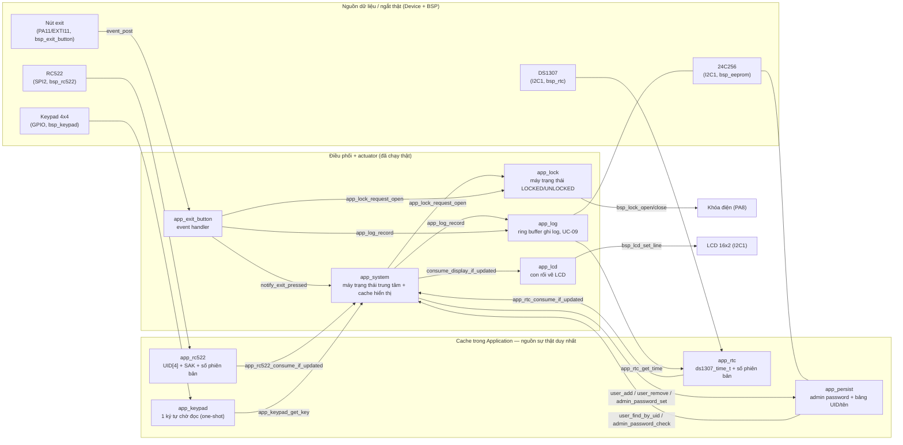

# Task & Luồng dữ liệu (Data Flow)

Trang này gom lại **toàn bộ task đang chạy thật** (trong `g_pTaskTable`/`g_pEventTable` của
`app_main.c`) và **đường đi của dữ liệu** giữa chúng — bổ sung cho [Module đã viết](modules.md)
(tả từng module riêng lẻ) bằng một góc nhìn "toàn cảnh": ai tạo dữ liệu, ai cache, ai tiêu thụ.

## Danh sách task trong scheduler

| Task | Chu kỳ | Nguồn dữ liệu | Có thể block bao lâu | Việc chính |
|---|---|---|---|---|
| `app_keypad_task` | 20ms | GPIO PA0-7 (`bsp_keypad`, quét ma trận) | ~0 (chỉ đọc GPIO) | Quét + debounce, latch 1 phím chờ đọc |
| `app_rtc_task` | 1000ms | DS1307 qua I2C1 (`bsp_rtc`) | 1 giao dịch I2C (ngắn, chuẩn I2C 100kHz) | Đọc giờ, cache + tăng số phiên bản |
| `app_rc522_task` | 200ms | RC522 qua SPI2 (`bsp_rc522`) | tối đa `RC522_TIMEOUT_MS` (**50ms**) nếu không có thẻ; +vài ms SPI nữa nếu có thẻ (anticollision+SELECT) | REQA; nếu có thẻ trả lời → đọc UID + halt ngay trong cùng lần gọi |
| `app_system_task` | 100ms | Cache của `app_rc522`/`app_keypad`/`app_rtc` + `app_persist` (toàn RAM, trừ `app_persist`/`app_log`'s hàm ghi - EEPROM thật) | ~0 khi chỉ đọc; vài chục ms nếu đang ghi `app_persist`/`app_log` (add/xoá user, đổi password, ghi log - hiếm/1 record nhỏ) | Máy trạng thái trung tâm (13 state) - xem [app-system.md](app-system.md) |
| `app_lock_task` | 100ms | RAM nội bộ (`os_tick_get()` so với mốc mở khóa) | ~0 | Hết 5s mở khóa chưa, nếu hết → `bsp_lock_close()` |
| `app_lcd_task` | 100ms | Cache hiển thị của `app_system` (RAM) | 1 giao dịch I2C mỗi dòng đổi (0-2 dòng/tick, thường 0) | Vẽ lại LCD nếu nội dung đổi |
| `app_led_task` | 500ms | RAM nội bộ (`dio_t.bStatus`, không nhận input module nào khác) | ~0 (chỉ toggle GPIO) | Toggle PC13 - 2 lần/chu kỳ = nhấp nháy 1s, xem [Kết nối & Pinout](../hardware/connections.md#9-led-trang-thai) |

`g_pEventTable` (mô-đun [event](modules.md#event)) có **1 entry thật**: nút exit (PA11/EXTI11,
`bsp_exit_button`) — khi nhấn, `app_exit_button_on_press()` gọi cả `app_lock_request_open()`
**và** `app_system_notify_exit_pressed()`, song song với đường task ở trên. Xem
[app-lock.md](app-lock.md)/[app-system.md](app-system.md) cho sơ đồ đầy đủ.

!!! warning "Rủi ro lập lịch cooperative: `app_rc522_task` có thể trễ các task khác"
    Scheduler ở đây **không ưu tiên** (no preemption) — `scheduler_run()` gọi lần lượt từng task
    đến hạn trong `g_pTaskTable`, task sau chỉ chạy khi task trước đã `return`. Vì
    `app_rc522_task` có thể block đồng bộ tới 50ms (khi không có thẻ, REQA timeout), nếu đúng lúc
    đó `app_keypad_task` cũng đến hạn (mỗi 20ms), nó phải **chờ `app_rc522_task` chạy xong** mới
    được gọi — một lần nhấn phím có thể bị trễ lên tới ~50ms trong trường hợp xấu nhất. Với tần
    suất quét phím 20ms và ngưỡng debounce hiện tại, mức trễ này chưa gây mất phím, nhưng là điểm
    cần nhớ nếu sau này hạ `RC522_TIMEOUT_MS` không phải là lựa chọn (nó là hằng số compile-time
    toàn cục, xem [rc522](modules.md#rc522-rfid-mfrc522-spi)) hoặc thêm task mới có yêu cầu thời
    gian chặt hơn.

## Sơ đồ luồng dữ liệu



Nét liền (`-->`) = đường dữ liệu/lệnh **đã chạy thật** — kể cả tới 2 actuator vật lý (khóa điện +
LCD) và tới EEPROM (ghi log) — `app_system` giờ là module trung tâm thật sự: đọc từ 3 cache + 1
kho lưu trữ, ghi ngược lại kho lưu trữ (khi admin thêm/xoá/đổi password), ghi log, và điều khiển
cả khóa và màn hình. **Không còn đường nét đứt nào trong sơ đồ này** — module cuối còn thiếu
(ghi log, UC-09) nay đã có `app_log`. Một ngoại lệ nhỏ không vẽ riêng: `app_lock_get_state()`
vẫn chưa có ai gọi (`arm-none-eabi-nm` xác nhận bị `--gc-sections` loại khỏi `.elf`) — `app_lcd`
hiện chỉ vẽ theo nội dung `app_system` quyết định, không tự hỏi `app_lock` trạng thái khóa.

## Pattern cache "2 accessor" dùng chung cho mọi nguồn dữ liệu bất đồng bộ

`app_rtc` và `app_rc522` đều dùng lại đúng một pattern, và `app_system` tự áp dụng nó lần thứ 3
cho cache hiển thị của chính mình (`app_system_consume_display_if_updated()`, tiêu thụ bởi
`app_lcd`) — đáng tách riêng ra đây vì đã được tái dùng 3 lần, không phải lý thuyết suông.
`app_system` cũng là consumer thật của 2 cache khác (xem sơ đồ ở trên: nó gọi
`app_rc522_consume_if_updated()` và `app_rtc_consume_if_updated()`), không chỉ là bên cung cấp:

```c
static tData       s_cachedData;     // bản mới nhất, Application giữ (không phải Device/BSP)
static uint32_t     s_ui32UpdateSeq; // tăng mỗi lần task đọc được dữ liệu MỚI thành công
static bool         s_bHasData;      // false cho tới lần đọc thành công đầu tiên

bool xxx_get_latest(tData *pOut);                               // không quan tâm mới/cũ
bool xxx_consume_if_updated(tData *pOut, uint32_t *pLastSeenSeq); // chỉ trả true nếu có bản MỚI
```

| Accessor | Dùng khi nào | Ví dụ thật |
|---|---|---|
| `xxx_get_latest()` (≡ `app_rtc_get_time`, `app_rc522_get_last_uid`) | Consumer phản ứng theo **sự kiện của chính nó**, không theo lịch — không quan tâm dữ liệu vừa cập nhật hay đã cũ, chỉ cần giá trị đúng tại thời điểm hỏi | `app_log_record()` gọi `app_rtc_get_time()` đúng lúc có sự kiện mở khóa, để dán nhãn giờ cho record — không quan tâm giờ đó đọc được từ khi nào (xem [app-log.md](app-log.md)) |
| `xxx_consume_if_updated()` (≡ `app_rtc_consume_if_updated`, `app_rc522_consume_if_updated`) | Consumer chạy **theo lịch riêng của nó** (ví dụ task vẽ LCD mỗi 100ms) và chỉ muốn làm việc khi dữ liệu *thực sự đổi* so với lần nó tự thấy gần nhất | Hiển thị LCD: không vẽ lại đồng hồ mỗi lần task LCD chạy, chỉ vẽ khi giây đã đổi |

Mỗi caller của `consume_if_updated()` tự giữ biến `pLastSeenSeq` riêng (khởi tạo `0`) — nhiều
consumer độc lập đọc cùng 1 cache không đụng nhau, vì mỗi bên so với biến phiên bản riêng của
chính mình, không có "con trỏ đọc chung" nào bị tranh chấp.

## Khi nào thêm task mới, khi nào dùng event

- **Thêm task mới vào `g_pTaskTable`** khi việc cần làm có thể diễn đạt bằng "mỗi N ms, kiểm tra
  một lần" — đúng với cả 7 task hiện có, kể cả `app_lock_task` (chỉ kiểm hết 5s chưa).
- **Dùng `event`** chỉ khi có một nguồn *bất đồng bộ thật* - một input rời rạc không có gì để
  "hỏi" định kỳ (nút exit - xem [app-lock.md](app-lock.md)), không phải "gói một lệnh blocking
  vào ngắt cho có" (RC522's lần thử đầu, đã bỏ) — xem phân tích đầy đủ ở mục
  [event](modules.md#event).
